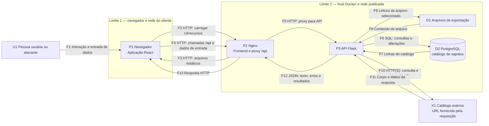

# Modelagem de ameaças — Cadastro de Sapatos

**Data da análise:** 14/10/2026
**Escopo:** aplicação web e execução local definida em `docker-compose.yml`: frontend servido pelo Nginx, API Flask, banco PostgreSQL, arquivos de exportação e integração com catálogo externo.
**Método:** DFD com limites de confiança e classificação STRIDE. Esta análise é baseada no código e na configuração presentes no repositório; não substitui teste de intrusão nem validação do ambiente implantado.

## Visão geral e ativos

A aplicação permite consultar, cadastrar, alterar, excluir e importar produtos. Também expõe funções de exportação de arquivos, geração de etiquetas, checksum, ping de host e consulta a um catálogo remoto.

Ativos que precisam de proteção:

- **A1 — Dados do catálogo:** marcas, modelos, tamanhos, cores, preços e estoque.
- **A2 — Disponibilidade e integridade:** API e banco devem permanecer acessíveis e os registros não devem ser alterados ou excluídos indevidamente.
- **A3 — Segredos:** credenciais do PostgreSQL e chaves de integração.
- **A4 — Dados e recursos do ambiente:** arquivos locais, serviços internos e recursos de rede acessíveis pelo backend.
- **A5 — Código e sessão do usuário:** frontend e dados apresentados no navegador.

## Diagrama de fluxo de dados (DFD)

### Limites e pressupostos

- O acesso ao frontend e à API é publicado pelo host Docker. O compose também publica a porta do PostgreSQL no host; portanto, não se deve presumir que o banco seja alcançável somente pela rede interna.
- O tráfego configurado entre cliente, Nginx e API é HTTP, sem TLS explícito no compose.
- Não há autenticação nem autorização nas rotas da API; as operações de escrita também são acessíveis sem identidade.
- O diagrama representa a integração externa acionada pela API. O endereço dessa integração vem da requisição, não de uma lista fixa de destinos.
- GitLab/Runner, pipeline de CI/CD e DefectDojo não fazem parte do DFD da aplicação em execução. Segurança da cadeia de build e da plataforma de DevSecOps requer análise própria.

## Ameaças priorizadas (STRIDE)

| ID | Prioridade | STRIDE | Ativo/fluxo | Cenário e impacto | Mitigação recomendada |
|---|---|---|---|---|---|
| T1 | Crítica | Tampering / Elevation of Privilege | A1, A2; F3–F6 | A API não exige autenticação ou autorização. Um visitante pode criar, alterar, importar ou excluir registros, comprometendo dados e estoque. | Exigir autenticação e autorização por operação; limitar rotas administrativas; validar a identidade no backend e registrar auditoria de alterações. |
| T2 | Crítica | Tampering / Information Disclosure | A1, D2; F5 | Consultas SQL são montadas por concatenação/interpolação de entradas (`q`, `id` e campos do produto). Injeção pode permitir leitura ou alteração indevida do banco. | Usar parâmetros SQL em todas as consultas; validar tipos, limites e formato dos campos; adicionar testes de segurança para cada endpoint. |
| T3 | Crítica | Elevation of Privilege / Information Disclosure | A4; F3–F4 | A importação YAML usa `yaml.load` com loader não seguro. Um documento malicioso pode executar comportamento arbitrário no processo backend, conforme a versão/configuração da biblioteca. | Trocar por `yaml.safe_load`, validar estrutura e tipos, limitar tamanho e quantidade de itens e rejeitar chaves inesperadas. |
| T4 | Alta | Spoofing / Information Disclosure | A3 | Credenciais e chaves estão codificadas em arquivos versionados e/ou imagem. Qualquer pessoa com acesso ao repositório ou à imagem pode reutilizá-las. O estado de validade não foi verificado. | Considerar os valores expostos: revogar e rotacionar imediatamente; remover do código e do histórico conforme o processo da organização; injetar segredos por mecanismo de secrets e evitar incluí-los em imagens. |
| T5 | Alta | Elevation of Privilege / Information Disclosure | A4; F9–F10 | A rota de catálogo aceita URL arbitrária, faz requisição a partir do backend e envia uma chave de API, com validação TLS desativada. Pode permitir SSRF, acesso a serviços internos e exfiltração da chave ao destino controlado pelo atacante. | Aceitar apenas destinos previamente permitidos; bloquear IPs privados, loopback, link-local e redirecionamentos para esses destinos; validar TLS; não enviar segredo a destinos definidos pelo usuário; aplicar timeout e limites de resposta. |
| T6 | Alta | Elevation of Privilege | A4; F3–F4 | A rota de ping concatena `host` em um comando de shell. Entrada maliciosa pode injetar comandos executados com os privilégios do backend. | Remover a execução de shell ou usar subprocesso com argumentos separados e validação estrita de hostname/IP; limitar privilégios e tempo de execução. |
| T7 | Alta | Tampering / Information Disclosure | A5; F11–F12 | Modelos de sapatos são renderizados como HTML no navegador e a busca é inserida com `dangerouslySetInnerHTML`. Dados persistidos podem causar XSS armazenado, execução no contexto de outros usuários e roubo de sessão/dados. | Renderizar texto escapado; remover `dangerouslySetInnerHTML` para dados não confiáveis; aplicar política CSP como defesa adicional e validar a saída. |
| T8 | Alta | Information Disclosure / Tampering | A4; F3–F4, F7–F8 | A exportação usa um nome de arquivo fornecido pelo cliente ao construir um caminho local. Sem restrição ao diretório pretendido, `../` pode permitir leitura de outros arquivos disponíveis ao processo. | Aceitar apenas nomes de arquivo permitidos (por exemplo, uma lista explícita); resolver e validar o caminho final contra `EXPORT_DIR`; não expor arquivos arbitrários. |
| T9 | Alta | Elevation of Privilege | A5; F3–F4 | A rota de etiquetas compila como template Jinja o conteúdo `template` fornecido pelo cliente. Template injection pode acessar objetos/contexto do servidor e, dependendo do ambiente, levar a exposição de dados ou execução de código. | Não compilar templates fornecidos pelo cliente; usar templates fixos e variáveis escapadas; se necessário, definir modelo restrito com sandbox e allowlist. |
| T10 | Alta | Denial of Service / Information Disclosure | A2, A4; F11–F12 | O handler global de exceções devolve a mensagem e o traceback completos. Erros podem revelar caminhos, consultas e detalhes internos; requisições inválidas também podem gerar respostas 500 e logs volumosos. | Retornar mensagem genérica e identificador de erro ao cliente; registrar detalhes somente em logs protegidos; tratar erros esperados com códigos apropriados. |
| T11 | Alta | Denial of Service | A2; F3–F10 | Importação sem limites, consultas sem paginação, ping e proxy externo sem controles suficientes podem consumir CPU, memória, conexões ou largura de banda. | Aplicar limites de tamanho, quantidade e frequência; paginação e timeouts; quotas e rate limiting no proxy/API; limitar concorrência e recursos dos containers. |
| T12 | Média | Information Disclosure / Tampering | A1, A5; F3–F4 | O uso de CORS permissivo amplia os sites que podem ler respostas no navegador. Como os endpoints não têm autenticação, não é a principal barreira de segurança e não impede chamadas diretas à API. | Restringir CORS às origens necessárias; não tratar CORS como controle de acesso; adicionar autenticação e proteção CSRF quando houver sessão baseada em cookies. |
| T13 | Média | Tampering / Repudiation | A1, A2; F3–F6 | Não há auditoria de quem alterou/importou/excluiu registros. Incidentes e alterações indevidas são difíceis de atribuir ou investigar. | Registrar identidade, operação, recurso, horário e resultado em log protegido; definir retenção e monitoramento sem incluir segredos. |
| T14 | Média | Denial of Service / Elevation of Privilege | A2, A4 | O processo de aplicação inicia em modo debug e usa o servidor de desenvolvimento Flask. Se exposto fora de um ambiente isolado, isso pode revelar detalhes e ampliar o impacto de falhas. | Desativar debug; servir com servidor WSGI de produção; não publicar portas de depuração; restringir portas e serviços ao mínimo necessário. |
| T15 | Média | Information Disclosure / Denial of Service | A3, A4; F5 | A porta do PostgreSQL está publicada no host e as credenciais estão estáticas. Exposição de rede combinada com credenciais reutilizáveis pode permitir acesso direto ao banco. | Remover a publicação da porta quando não necessária; restringir binding/firewall; rotacionar credenciais; usar usuário de banco com privilégios mínimos e rede privada. |
| T16 | Baixa | Spoofing / Tampering | A1; F3–F6 | O endpoint de checksum usa MD5. O valor não autentica o registro e é inadequado como prova contra adulteração ou colisões deliberadas. | Remover se não houver necessidade funcional; para integridade, usar HMAC com chave protegida ou assinatura apropriada e definir claramente o dado coberto. |

**Prioridade** indica urgência relativa considerando exposição observada e impacto potencial; a exploração depende do ambiente, das permissões e das versões efetivamente implantadas. A presença de uma chave no código não confirma que ela esteja ativa.

## Plano de tratamento recomendado

1. **Conter exposição imediata:** revogar/rotacionar todos os segredos versionados; manter a API e o PostgreSQL inacessíveis a redes não confiáveis enquanto não houver autenticação.
2. **Eliminar execução/injeção:** parametrizar SQL; trocar o loader YAML; remover shell no ping; não aceitar templates Jinja arbitrários.
3. **Fechar acessos indiretos:** restringir destinos de SSRF, validar TLS e impedir leitura de arquivos fora do diretório de exportação.
4. **Proteger usuários e operações:** exigir autenticação/autorização, escapar conteúdo HTML, limitar CORS e registrar operações administrativas.
5. **Endurecer execução:** desligar debug, usar servidor WSGI de produção, restringir portas, adicionar timeouts, limites de requisição e monitoramento.
6. **Verificar correções:** criar testes negativos para injeção SQL, YAML, SSRF, path traversal, XSS e controle de acesso; executar SAST/DAST e revisar configuração e segredos das imagens.

## Referências de implementação

- API e rotas: [backend/app.py](./backend/app.py)
- Configuração e segredos: [backend/config.py](./backend/config.py), [backend/Dockerfile](./backend/Dockerfile)
- Persistência: [backend/db.py](./backend/db.py)
- Interface e chamadas HTTP: [frontend/src/App.jsx](./frontend/src/App.jsx), [frontend/src/api.js](./frontend/src/api.js)
- Proxy e portas da aplicação: [frontend/nginx.conf](./frontend/nginx.conf), [docker-compose.yml](./docker-compose.yml)
- Dependências da API: [backend/requirements.txt](./backend/requirements.txt)
